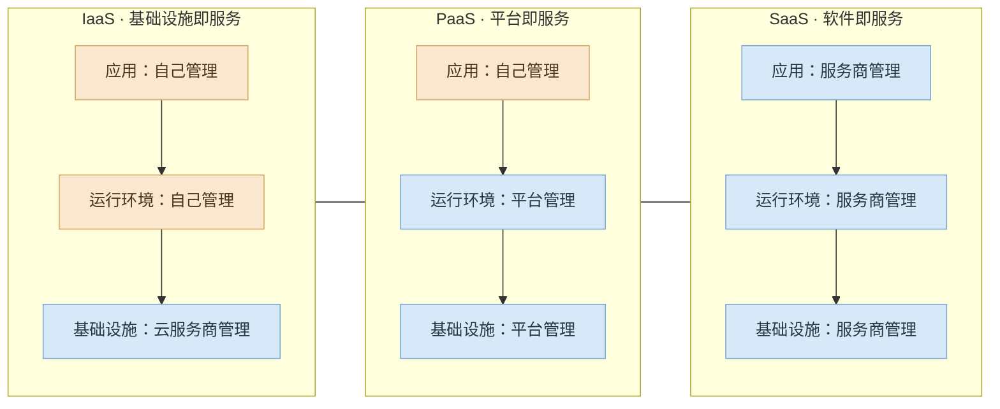

#  分析型与事务型系统

1. 事务性系统 operational sysytem：由创建数据的后端服务和数据基础设施组成。应用代码根据**用户执行的操作**，读取和修改数据库中的数据。
2. 分析型系统 analytical system：服务于业务分析师和数据科学家，保存事务型系统数据的只读副本。
3. OLTP 与OLAP的区别。   

| 属性 | 事务型系统（OLTP） | 分析型系统（OLAP） |
|------|--------------------|--------------------|
| 主要读取模式 | 点查询（按键读取单条记录） | 聚合大量记录 |
| 主要写入模式 | 创建、更新和删除单条记录 | 批量导入（ETL）或事件流 |
| 人类用户示例 | Web 或移动应用的最终用户 | 为决策提供支持的内部分析师 |
| 机器用途示例 | 检查某项操作是否获得授权 | 检测欺诈或滥用模式 |
| 查询类型 | 由应用预先定义的一组固定查询 | 分析师可以任意查询 |
| 数据表示的内容 | 数据的最新状态（当前时点） | 一段时间内发生的事件历史 |
| 数据集规模 | GB 至 TB | TB 至 PB |

4. 一次查询返回多少数据与它需要处理多少数据是两回事： 某个接口比如查询上月用电量，可能只返回一条数据，但是为了这条数据实际处理了大量的数据。把这种接口跟下单接口共用数据库肯定不行。
5. 分析系统的输出再提供给事务型系统用 ==> 反向ETL（reverse ETL）。

## 数据仓库 data warehouse

1. 数据孤岛data silo ：所需数据散落在多个事务型系统中很难通过一条组合查询，就叫数据孤岛。

2. 数据仓库保存各个OLTP系统数据的只读副本（数据经历ETL流程 提取-> 转换 -> 加载 进入数据仓库）。

## 数据湖 data lake

1. 数据仓库通常采用关系数据模型。但是对于 特征工程（feature engineering，数据行列转换为数值向量或矩阵）、文本数据应用自然语言处理 ，关系数据模型满足不了 ==> 采用数据湖，只保存文件，用便宜的对象存储。
2. 数据存在数据湖中，消费者可以依据需要把数据转换成自己需要的形式、不通的数仓模式使用。
3. 数据湖仓data lakehouse：在数据湖文件存储上增加查询执行引擎和元数据层，直接运行典型数仓工作如SQL查询等。

## 记录系统与衍生数据

1. system of record记录系统是数据来源，衍生数据系统derived data system可以根据原始数据重建。

# 云服务与自托管

## 云原生系统架构 cloud-native

1. 云原生系统架构：专为利用云服务优势而设计的架构。

2. 云服务的分层：IaaS、PaaS、SaaS是不同层次的云服务，都可以面向客户提供，上层服务依赖下层的基础能力。

| 模式   | 英文全称                        | 中文名称    | 服务商提供什么        | 典型例子                                |
| ---- | --------------------------- | ------- | -------------- | ----------------------------------- |
| IaaS | Infrastructure as a Service | 基础设施即服务 | 服务器、存储、网络等基础设施 | 阿里云 ECS、AWS EC2                     |
| PaaS | Platform as a Service       | 平台即服务   | 应用运行环境、开发和部署平台 | Google App Engine、Azure App Service |
| SaaS | Software as a Service       | 软件即服务   | 可直接使用的完整软件     | Microsoft 365、Salesforce、企业微信       |

